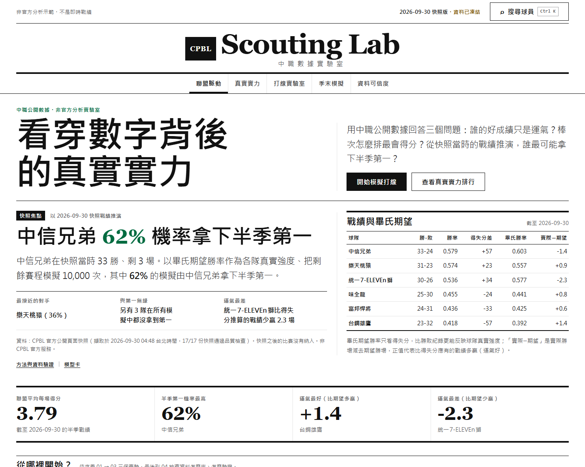
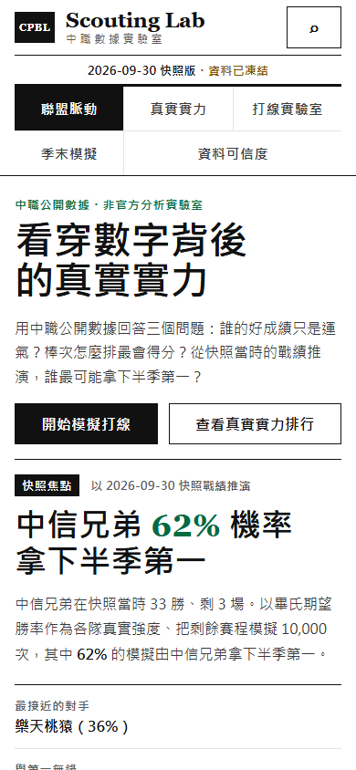
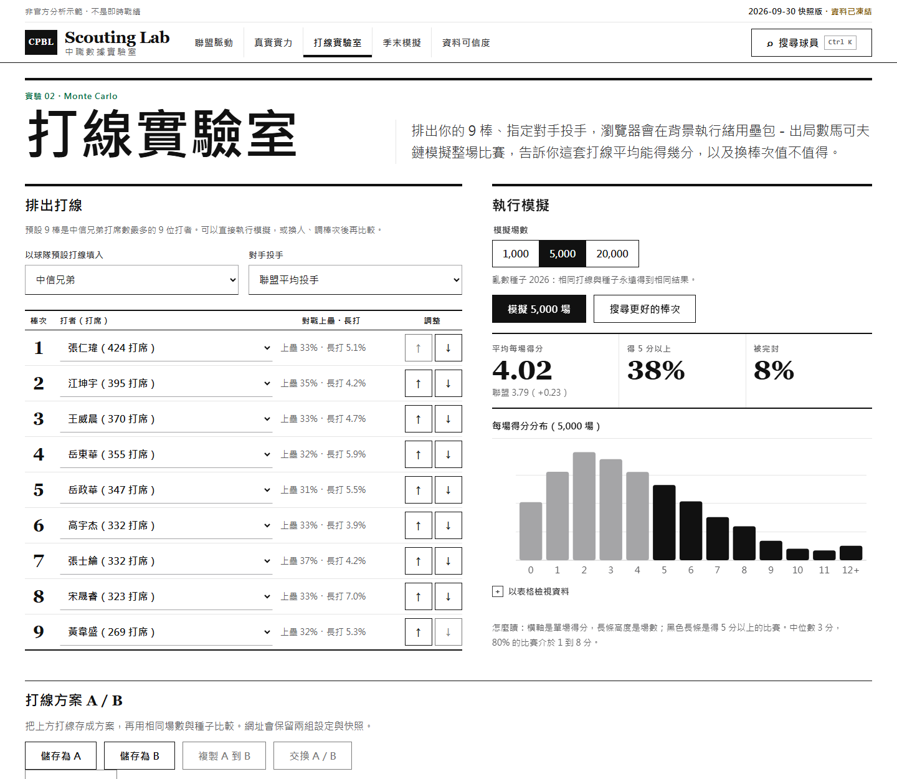
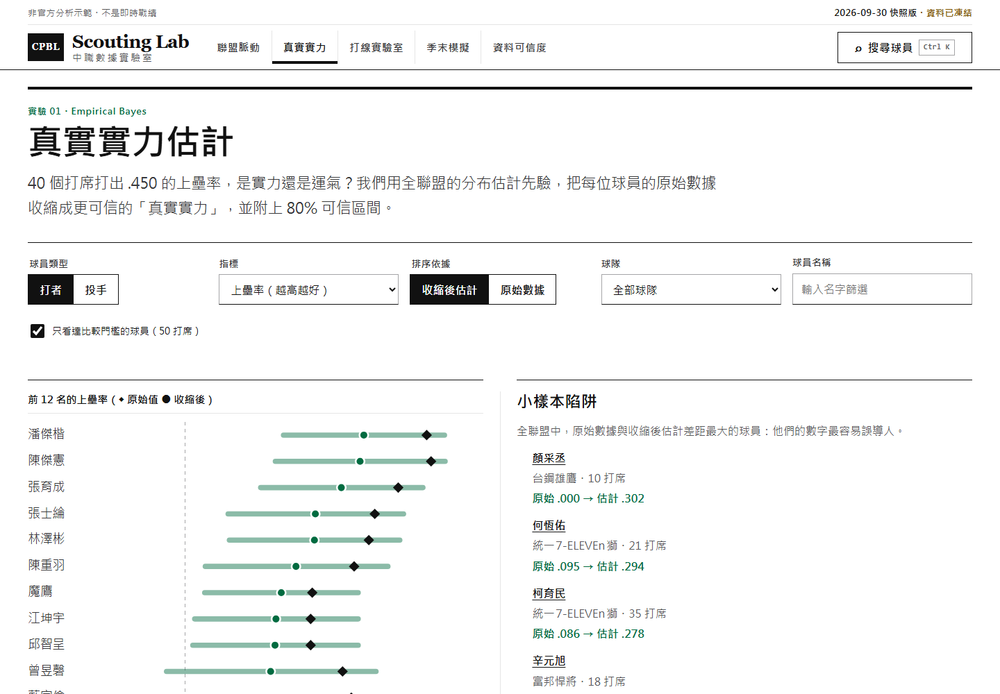
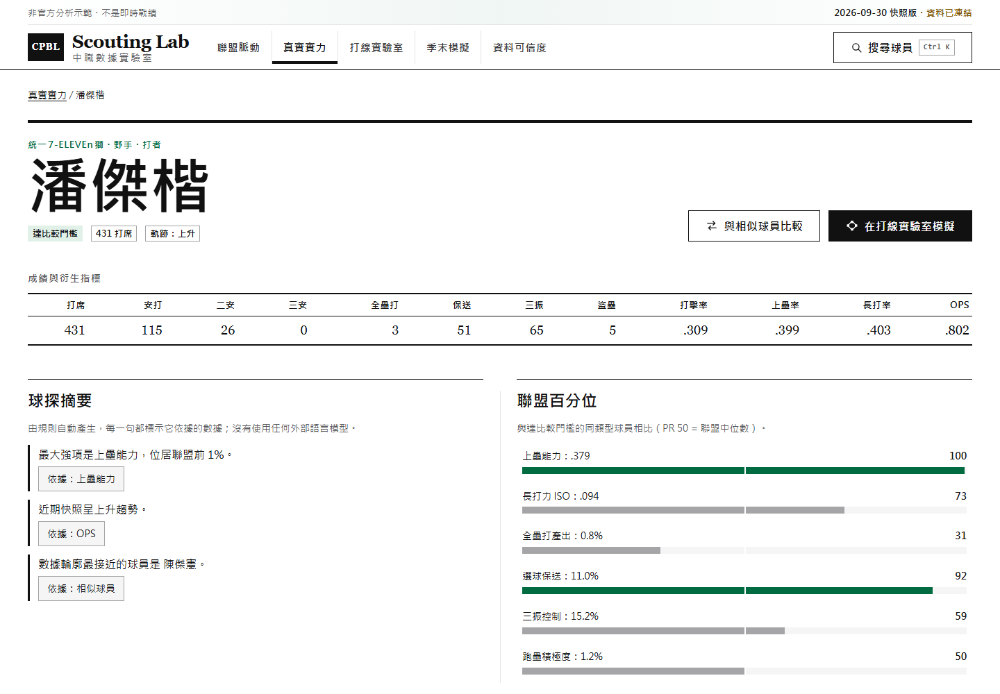
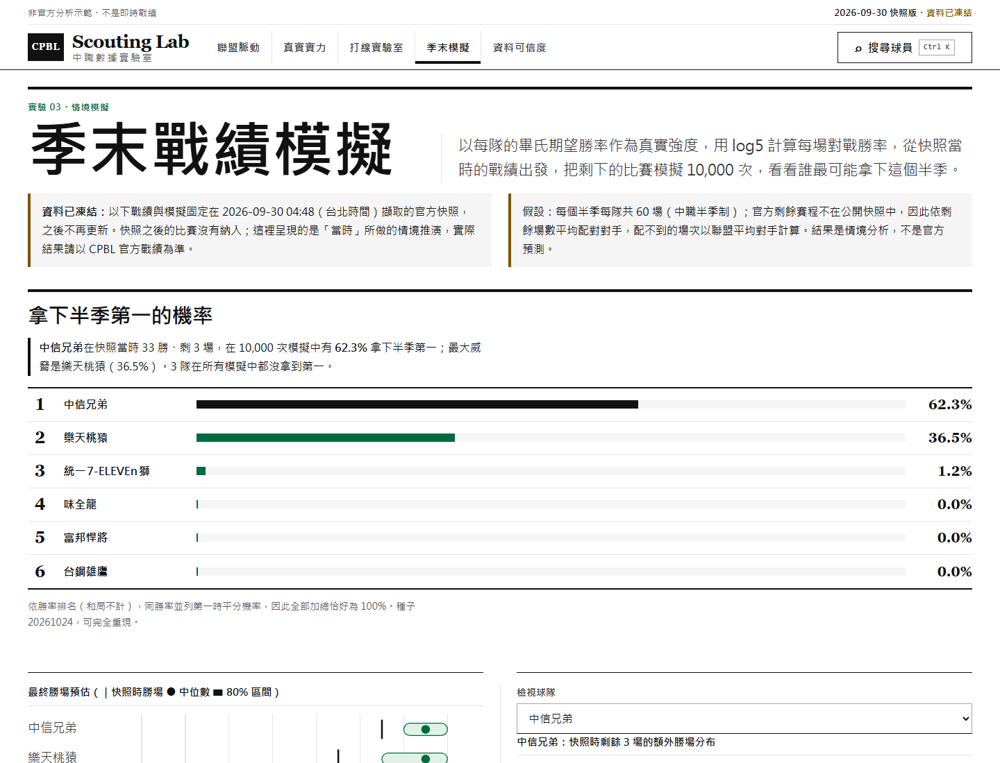
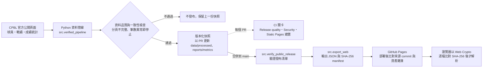

# CPBL Scouting Lab

[](https://github.com/Lily09-project/CPBL-baseball/actions/workflows/release-quality.yml)
[](https://github.com/Lily09-project/CPBL-baseball/actions/workflows/security.yml)

以中華職棒公開資料建置的互動式棒球分析網站，結合球員評估、打線模擬與賽季情境分析。

**[開啟線上展示](https://lily09-project.github.io/CPBL-baseball/)**

| 桌面版 | 手機版 |
| --- | --- |
|  |  |

## 3 分鐘 Demo 路線

照順序點開下列連結，就能走完整個網站的核心導覽；每個連結都把畫面狀態寫在網址裡，打開即是同一個畫面。

1. **[小樣本陷阱](https://lily09-project.github.io/CPBL-baseball/#/talent?type=batter&metric=obp&sort=raw&all=1)**：打者上壘率依「原始數據」排序並納入未達門檻的球員，榜首是打席極少的「小樣本」；切到「收縮後估計」排名立刻改變。說明 Empirical Bayes 如何用聯盟先驗修正小樣本，並附 80% 可信區間。
2. **[單一球員檔案](https://lily09-project.github.io/CPBL-baseball/#/player/batter/0000007629)**：「小樣本陷阱」清單上的一位打者，10 個打席上壘率 .000，收縮後估計約 .302。展示能力區間、快照軌跡，以及每一句都標註依據的規則式球探摘要。
3. **[打線 A／B 比較](https://lily09-project.github.io/CPBL-baseball/#/lineup?team=%E4%B8%AD%E4%BF%A1%E5%85%84%E5%BC%9F&seed=2026&games=5000&snapshot=20260929T204833Z-5e0600df3416&a=0000006730,0000004636,0000000929,0000002291,0000005571,0000002285,0000007085,0000006225,0000005298&b=0000007085,0000004636,0000000929,0000002291,0000005571,0000002285,0000006730,0000006225,0000005298)**：兩組方案只差第 1、7 棒，按「比較兩組打線」。以 log5 算對戰機率、在 Web Worker 中跑 Monte Carlo，兩組用相同種子與場數，得到 B − A 的得分差與 95% 配對模擬區間；網址可重現同一結果。
4. **[季末戰績模擬](https://lily09-project.github.io/CPBL-baseball/#/season)**：以畢氏期望勝率與 log5 從快照當時的戰績出發，模擬剩餘賽程 10,000 次（固定種子），得到各隊拿下半季第一的機率與最終勝場的 80% 區間。頁面清楚標示這是快照當時的情境推演。
5. **[資料可信度](https://lily09-project.github.io/CPBL-baseball/#/data)**：瀏覽器以 Web Crypto 重新計算每個資料檔的 SHA-256 並與 manifest 比對；同頁說明資料為何凍結在 2026-09-30 快照，以及官方來源與方法限制。

## 功能

- **打線 A／B 方案**：保存兩組打線，以相同種子比較得分差異，可一鍵複製比較網址與下載 CSV，亦可在瀏覽器中命名並保存常用打線。

- **聯盟脈動（首頁）**：像運動日報頭版，以快照日期為出刊日，頭條是由資料算出的半季第一機率，附戰績與畢氏期望勝率對照表
- **真實實力**：以 Empirical Bayes 修正小樣本，估計打者與投手的真實能力，可依球隊篩選、切換是否只看達比較門檻的球員
- **球員檔案**：單一球員的能力估計區間、快照趨勢、相似球員與規則產生的球探摘要
- **球員比較**：最多 3 位同類型球員並列比較，可下載 CSV／JSON
- **打線實驗室**：以 log5 估計對戰結果，用 Monte Carlo 模擬每場得分，比較不同打序
- **季末模擬**：用 Monte Carlo 模擬剩餘賽程，依勝率（和局不計）估計各隊奪得半季第一的機率
- **資料可信度**：資料快照與 SHA-256 完整性驗證

## 畫面

| 打線實驗室 | 真實實力估計 |
| --- | --- |
|  |  |
| **球員檔案** | **季末戰績模擬** |
|  |  |

截圖取自正式網站的 CPBL 公開資料快照。改版上線後在 `web/` 執行 `npm run screenshots` 即可重拍，截圖清單在 `docs/screenshots/shots.json`。

## 資料與評估邊界

官方 CPBL 資料來源包含[球員](https://www.cpbl.com.tw/player)、[戰績](https://www.cpbl.com.tw/standings/season)及[成績統計](https://www.cpbl.com.tw/stats/recordall)等公開頁面。資料經過資料品質與可稽核性檢查後，以 PR 更新版本化快照；任何頁面抓取不完整或分頁不一致都會停止，不會發布部分資料。網站使用靜態資料，不是即時服務。

> **資料已凍結在 2026-09-30 04:48（台北時間）擷取的快照。** 自 2026-10-03 起，CPBL 官方網站的 CDN 拒絕自動化請求；本專案不偽裝瀏覽器、也不繞過防護，因此停用每日排程，不發布之後的資料。網站的報頭、頁尾、季末模擬頁與資料可信度頁都會標示快照時間與凍結狀態，季末模擬呈現的是「快照當時」對下半季的情境推演。`data-refresh.yml` 與 `data-health.yml` 仍可手動執行，來源恢復可用時再重新啟用排程。

這是非 CPBL 官方服務，估計與模擬僅供研究和情境比較，不代表官方預測。

## 工程重點

Python 資料處理與分析、React、TypeScript、Vite、Web Worker；GitHub Pages 提供靜態網站。介面採黑白「運動日報頭版」排版：報頭、頭條、多欄專題與 box score 風格表格，手機版為單欄並保留三欄版面索引；設計原則見 [DESIGN.md](DESIGN.md)。



- **寧可凍結，也不繞過防護**：CPBL 官方 CDN 自 2026-10-03 起拒絕自動化請求後，管線維持誠實的 User-Agent、不偽裝瀏覽器，停用每日排程，網站各處標示快照時間與凍結狀態。
- **不發布部分資料**：任何分頁不完整或資料筆數低於下限都會讓管線失敗；資料更新由 `data-refresh.yml` 開 PR 進入 `main`，跑與程式碼變更相同的 CI 關卡。
- **端到端可驗證**：`export_web` 為每個資料檔寫入 SHA-256 manifest，CI 連跑兩次匯出並 `diff` 證明輸出可重現；前端載入時逐檔比對雜湊，不符就顯示錯誤而不是錯的數字；部署後再比對線上 `deployment.json` 的來源 commit 與資產雜湊。
- **可重現的模擬**：打線與季末模擬都用固定種子的亂數產生器，A／B 比較兩組方案使用相同的逐場種子（common random numbers），差異來自打線本身而非抽樣雜訊；打線模擬在 Web Worker 中執行，不卡住介面。
- **狀態都在網址**：hash 路由讓任何畫面（篩選、打線、種子、場數、A／B 方案）都能直接分享，也能在 GitHub Pages 這類純靜態主機上運作。
- **品質關卡寫進 CI**：Python 分析覆蓋率 ≥ 90%、前端單元測試覆蓋率 ≥ 85%、型別檢查與 lint、效能預算、Playwright 端到端與無障礙檢查，另有秘密掃描、Bandit、Ruff 與相依套件稽核。

## 本機執行與驗證

需求：Python 3.12、Node.js 22。

```powershell
.\run_project.bat
.\run_project.bat --validate
.\run_project.bat --check
.\run_project.bat --offline-check
```

```bash
python -m pytest -q
python -m src.verify_public_release reports/metrics/public_release_manifest.json
```

細節：[驗收](docs/ACCEPTANCE.md) · [模型卡](docs/MODEL_CARD.md) · [架構](docs/ARCHITECTURE.md) · [部署](docs/DEPLOYMENT.md) · [發布清單](docs/RELEASE_CHECKLIST.md) · [審查指南](docs/REVIEW_GUIDE.md) · [GitHub Pages](docs/GITHUB_PAGES.md) · [安全政策](SECURITY.md)

## 公開儲存庫政策

可公開追蹤：程式碼、測試、`data/processed/`、`reports/metrics/`、必要文件與介面截圖。
永不追蹤：`data/raw/`、`.env`、金鑰、憑證、`web/node_modules/`、本機建置產物與使用者資料。
