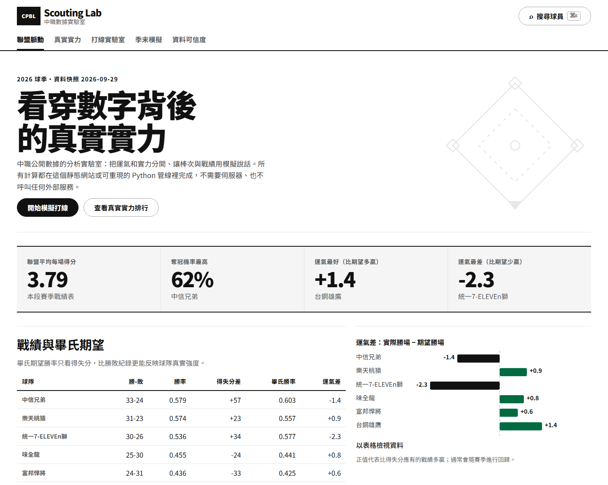
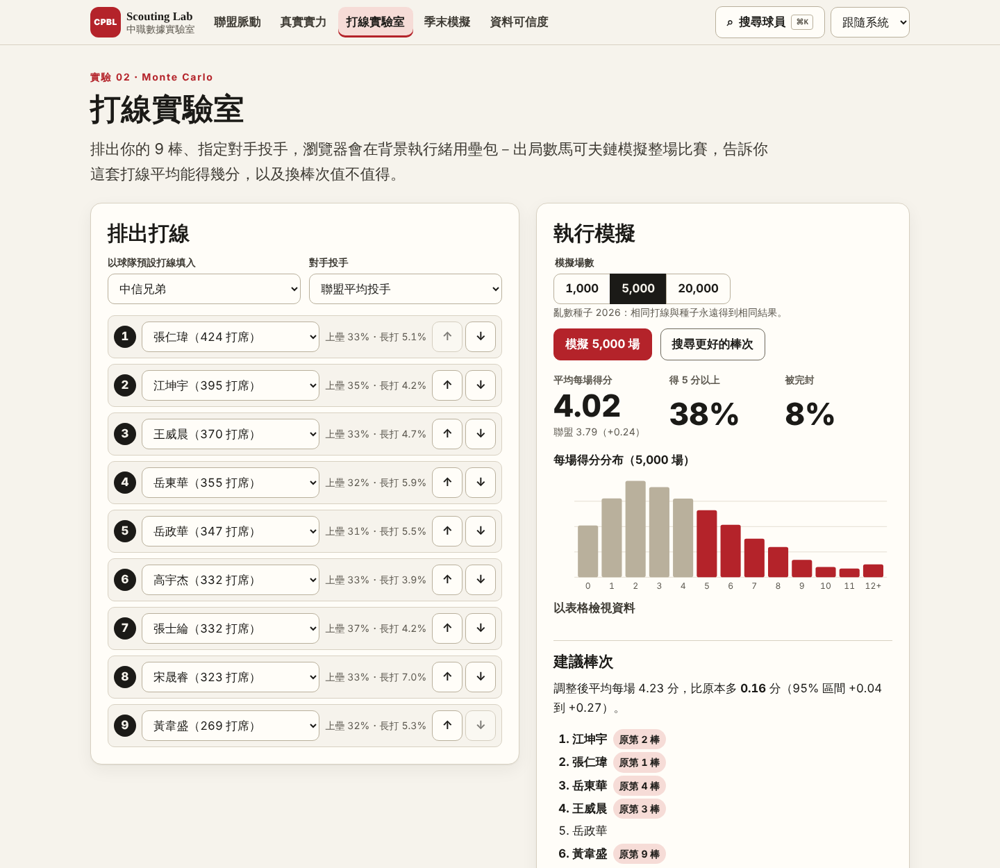
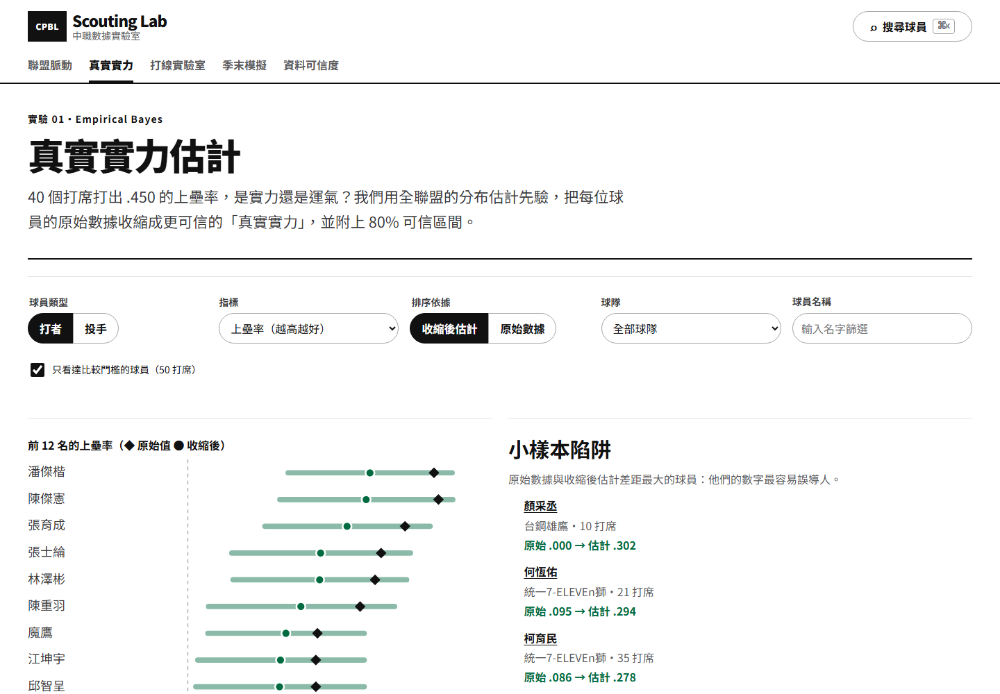
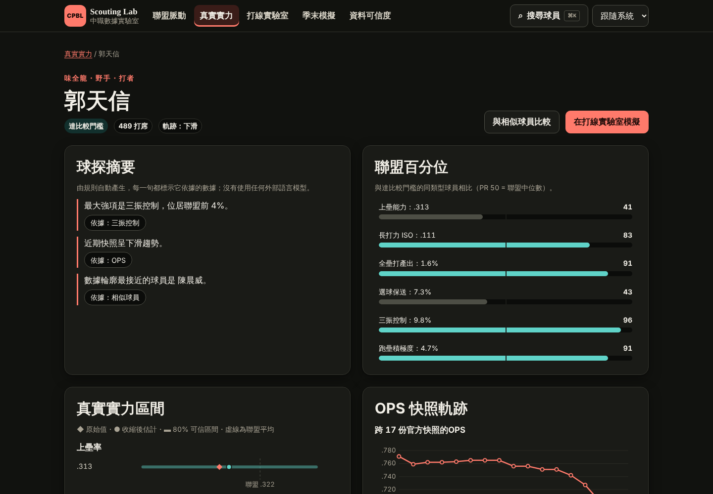
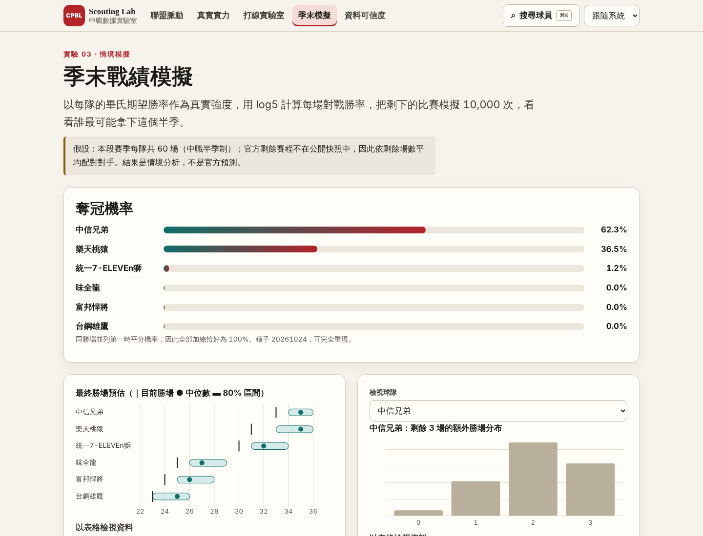
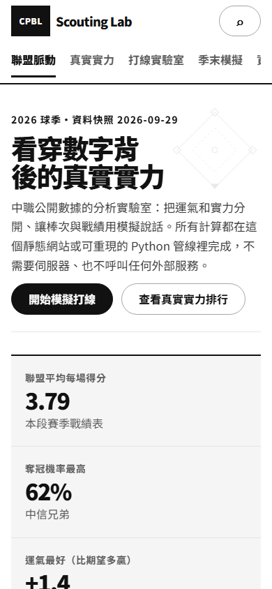
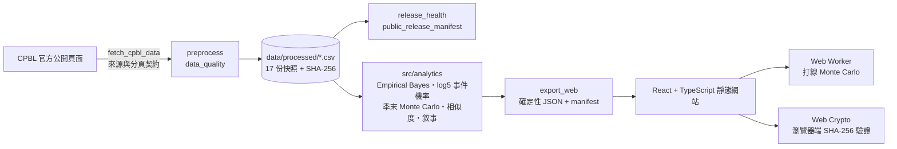

# CPBL Scouting Lab — 中職數據實驗室

[](https://github.com/Lily09-project/CPBL-baseball/actions/workflows/release-quality.yml)
[](https://github.com/Lily09-project/CPBL-baseball/actions/workflows/security.yml)

> 把中職官方公開數據變成可以「實驗」的分析產品：分開運氣與實力、在瀏覽器裡模擬打線與戰績，而且每一個數字都能驗證來源。

**[▶ 開啟線上實驗室](https://lily09-project.github.io/CPBL-baseball/)**：純靜態網站，不需登入、不需伺服器，所有計算都在你的瀏覽器裡完成。



## 為什麼做這個

傳統的成績排行榜有兩個問題：**小樣本的數字會騙人**（40 個打席打出 .450 的上壘率，不代表他是聯盟最強的打者），而**「如果……會怎樣」的問題沒辦法回答**（這套棒次好不好？剩下的賽程誰最可能奪冠？）。這個專案用統計推論與模擬回答這兩類問題，並把方法、假設與限制完整公開。

## 四個實驗

| 實驗 | 回答的問題 | 方法 |
| --- | --- | --- |
| **真實實力估計** | 這位球員的數字有多少是運氣？ | Empirical Bayes：以聯盟分布用動差法估計 Beta 先驗（扣除二項抽樣雜訊），輸出後驗平均與 80% 可信區間，並自動列出「小樣本陷阱」 |
| **打線實驗室** | 這 9 棒對上這位投手平均能得幾分？換棒次值得嗎？ | 在 Web Worker 中跑壘包－出局數馬可夫鏈 Monte Carlo；廣義 log5 結合打者與投手；以共同亂數（common random numbers）做棒次局部搜尋，附 95% 信賴區間 |
| **季末戰績模擬** | 剩下的比賽，誰最可能拿下半季冠軍？ | 畢氏期望勝率作為真實強度、log5 單場勝率，模擬剩餘賽程 10,000 次（固定種子可重現） |
| **可驗證的球員檔案** | 他的強項、弱點、趨勢與最像誰？ | 聯盟百分位、17 份官方快照的軌跡與趨勢判讀、可解釋的相似度（各特徵貢獻加總即相似度）、**每一句都附數據證據的自動球探摘要**（規則式生成，不使用外部語言模型） |



<table>
  <tr>
    <td></td>
    <td></td>
  </tr>
  <tr>
    <td></td>
    <td></td>
  </tr>
</table>

## 架構



- **資料工程**：官方頁面 → 品質檢查 → 版本化快照 → 公開清單。匯出是確定性的（排序、固定位數、以快照時間取代系統時間），CI 連跑兩次並比對位元組。
- **統計與模擬**：所有演算法在 `src/analytics/` 與 `web/src/lib/` 自行實作（包含不完全 Beta 函數與模擬引擎），沒有黑盒套件；模擬器以聯盟平均打線校準，誤差 2.6%。
- **前端**：React 19 + TypeScript + Vite、手寫 SVG 圖表（d3-scale）、Hash 路由讓每個畫面狀態都能分享、`⌘K` 快速搜尋、淺色／深色主題、頁面延遲載入；首屏 JS 85 KB（gzip）。
- **可及性與安全**：每張圖都有等價的資料表、純鍵盤可操作、axe-core 零 serious/critical；嚴格 CSP、無 inline script、執行期不呼叫第三方、CSV 匯出防公式注入。

## 本機啟動

需求：Python 3.12、Node.js 22。

**Windows**

```powershell
git clone https://github.com/Lily09-project/CPBL-baseball.git
cd CPBL-baseball
.\run_project.bat
```

**macOS／Linux**

```bash
python3.12 -m venv .venv && .venv/bin/pip install -r requirements.lock.txt
.venv/bin/python -m src.export_web          # 由已驗證快照產生網站資料
cd web && npm ci && npm run build && npm run preview
```

## 測試與驗收

驗收標準在重做開始前就訂在 [docs/ACCEPTANCE.md](docs/ACCEPTANCE.md)，每一項都對應自動化測試：

| 層級 | 指令 | 標準 |
| --- | --- | --- |
| Python 分析 | `python -m pytest -q --cov=src.analytics --cov-fail-under=90` | 全數通過；分析模組覆蓋率 ≥ 90%（目前 99%） |
| 前端邏輯 | `npm run typecheck && npm run lint && npm run coverage` | 0 錯誤；`web/src/lib` 覆蓋率 ≥ 85%（目前 99%） |
| 端對端 | `npm run e2e` | 4 種組合（1440 淺色／深色、768、390）× 每個使用者旅程，含 axe 無障礙、鍵盤、無 console error |
| 效能 | `npm run size` | 首屏 JS ≤ 200 KB、首屏資料 ≤ 800 KB |
| 發布 | `python -m src.release_gate`、`python -m src.verify_public_release reports/metrics/public_release_manifest.json` | 資料完整性與公開清單一致 |

Windows 一鍵檢查：`run_project.bat --validate`（全部離線檢查）、`run_project.bat --check`、`run_project.bat --offline-check`（只驗證已提交的資料）。

## 資料品質與評估邊界

資料管線只採用官方 CPBL 資料來源（[球員](https://www.cpbl.com.tw/player)、[戰績](https://www.cpbl.com.tw/standings/season)、[成績](https://www.cpbl.com.tw/stats/recordall)），每份快照都經過資料品質與可稽核性檢查，並以 SHA-256 記錄在公開清單中。

- 收縮後的估計是描述性的「目前最可信的值」，不是下個月表現的預測。
- 打線模擬不考慮守備、盜壘、換投與球場因素，適合比較不同棒次的**相對**差異。
- 季末模擬假設本段賽季共 60 場（中職半季制），剩餘對手依場數平均配對，是情境分析而非官方預測。
- 非 CPBL 官方服務，也不是即時戰績；資料停在快照時間，網站會顯示資料年齡。

細節見 [方法與模型卡](docs/MODEL_CARD.md)、[架構](docs/ARCHITECTURE.md)、[部署](docs/DEPLOYMENT.md)、[GitHub Pages](docs/GITHUB_PAGES.md)、[發布清單](docs/RELEASE_CHECKLIST.md)、[審查指南](docs/REVIEW_GUIDE.md)，安全通報見 [SECURITY.md](SECURITY.md)。

## 公開儲存庫政策

可公開追蹤：程式碼、測試、經驗證的發布資料（`data/processed/`、`reports/metrics/`）、必要文件及介面截圖。
永不追蹤：`data/raw/`、`.env`、金鑰與憑證、`web/node_modules/`、建置產物與網站匯出資料（由 CI 產生）、個人資料與本機暫存。
