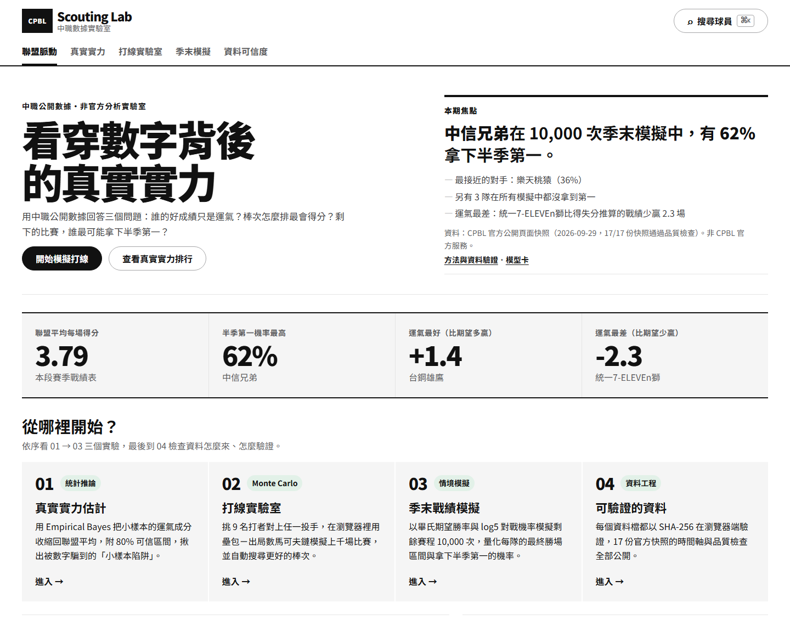
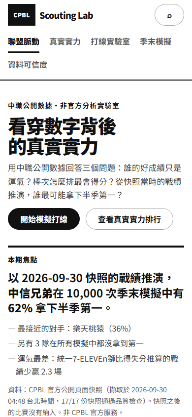
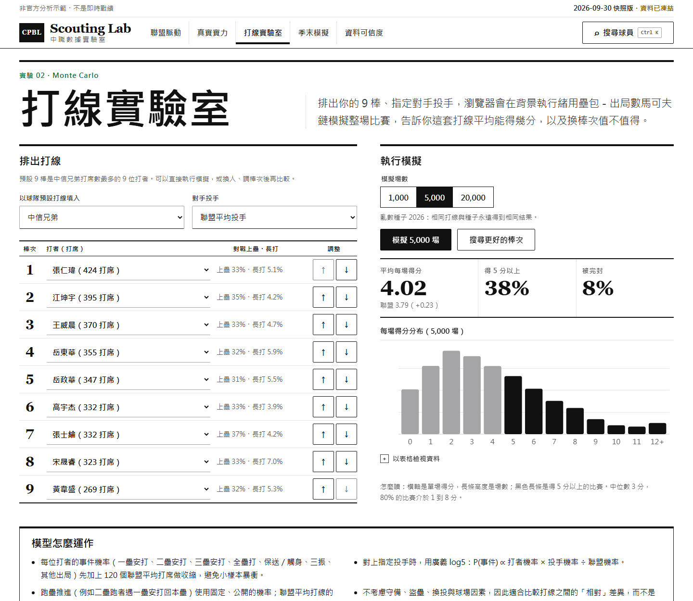
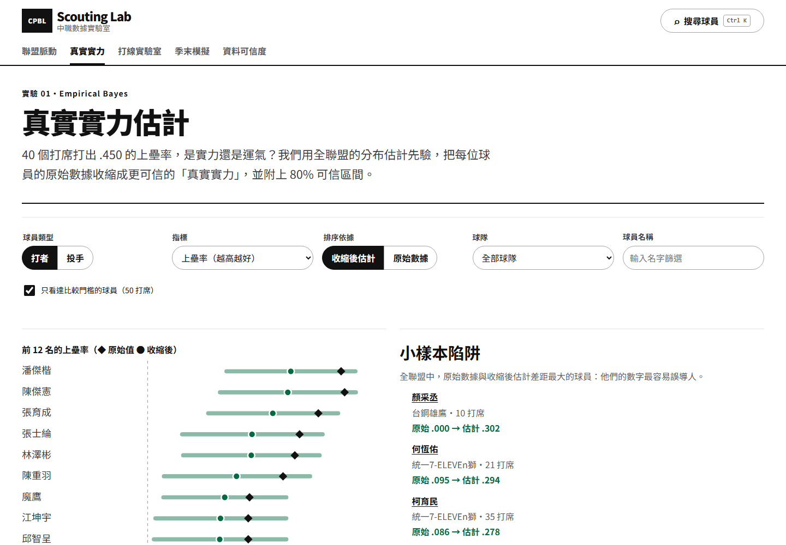
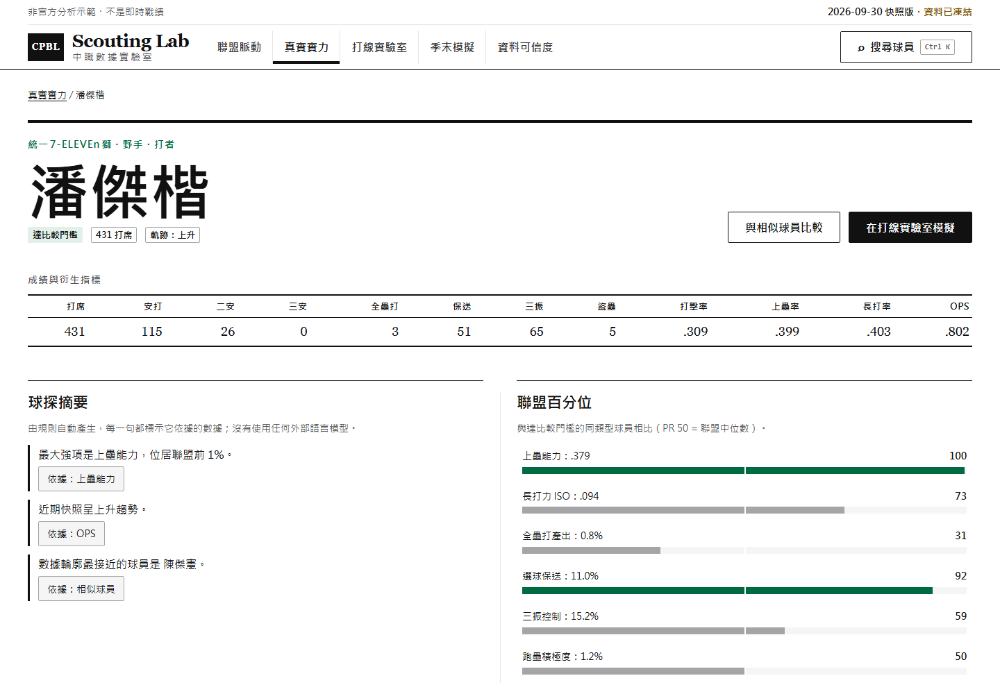
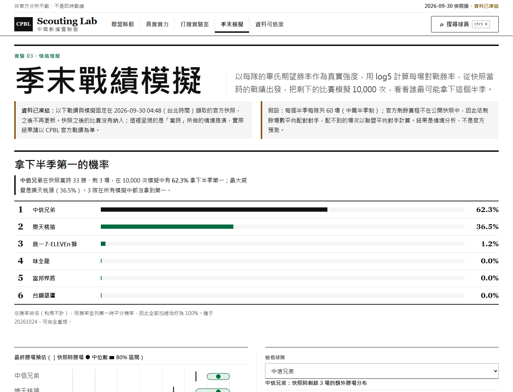

# CPBL Scouting Lab

[](https://github.com/Lily09-project/CPBL-baseball/actions/workflows/release-quality.yml)
[](https://github.com/Lily09-project/CPBL-baseball/actions/workflows/security.yml)

以中華職棒公開資料建置的互動式棒球分析網站，結合球員評估、打線模擬與賽季情境分析。

**[開啟線上展示](https://lily09-project.github.io/CPBL-baseball/)**

| 桌面版 | 手機版 |
| --- | --- |
|  |  |

## 功能

- **聯盟脈動（首頁）**：像運動日報頭版，以快照日期為出刊日，頭條是由資料算出的半季第一機率，附戰績與畢氏期望勝率對照表
- **真實實力**：以 Empirical Bayes 修正小樣本，估計打者與投手的真實能力，可依球隊篩選、切換是否只看達比較門檻的球員
- **球員檔案**：單一球員的能力估計區間、快照趨勢、相似球員與規則產生的球探摘要
- **球員比較**：最多 3 位同類型球員並列比較，可下載 CSV／JSON
- **打線實驗室**：以 log5 估計對戰結果，用 Monte Carlo 模擬每場得分，比較不同打序
- **季末模擬**：用 Monte Carlo 模擬剩餘賽程，依勝率（和局不計）估計各隊奪得半季第一的機率
- **資料可信度**：資料快照與 SHA-256 完整性驗證

## 畫面

| 打線實驗室 | 真實實力估計 |
| --- | --- |
|  |  |
| **球員檔案** | **季末戰績模擬** |
|  |  |

截圖取自正式網站的 CPBL 公開資料快照。

## 資料與評估邊界

官方 CPBL 資料來源包含[球員](https://www.cpbl.com.tw/player)、[戰績](https://www.cpbl.com.tw/standings/season)及[成績統計](https://www.cpbl.com.tw/stats/recordall)等公開頁面。資料經過資料品質與可稽核性檢查後，以 PR 更新版本化快照；任何頁面抓取不完整或分頁不一致都會停止，不會發布部分資料。網站使用靜態資料，不是即時服務。

> **資料已凍結在 2026-09-30 04:48（台北時間）擷取的快照。** 自 2026-10-03 起，CPBL 官方網站的 CDN 拒絕自動化請求；本專案不偽裝瀏覽器、也不繞過防護，因此停用每日排程，不發布之後的資料。網站的報頭、頁尾、季末模擬頁與資料可信度頁都會標示快照時間與凍結狀態，季末模擬呈現的是「快照當時」對下半季的情境推演。`data-refresh.yml` 與 `data-health.yml` 仍可手動執行，來源恢復可用時再重新啟用排程。

這是非 CPBL 官方服務，估計與模擬僅供研究和情境比較，不代表官方預測。

## 技術

Python 資料處理與分析、React、TypeScript、Vite、Web Worker；GitHub Pages 提供靜態網站。介面採黑白「運動日報頭版」排版：報頭、頭條、多欄專題與 box score 風格表格，手機版為單欄並保留三欄版面索引；設計原則見 [DESIGN.md](DESIGN.md)。

## 本機執行與驗證

需求：Python 3.12、Node.js 22。

```powershell
.\run_project.bat
.\run_project.bat --validate
.\run_project.bat --check
.\run_project.bat --offline-check
```

```bash
python -m pytest -q
python -m src.verify_public_release reports/metrics/public_release_manifest.json
```

細節：[驗收](docs/ACCEPTANCE.md) · [模型卡](docs/MODEL_CARD.md) · [架構](docs/ARCHITECTURE.md) · [部署](docs/DEPLOYMENT.md) · [發布清單](docs/RELEASE_CHECKLIST.md) · [審查指南](docs/REVIEW_GUIDE.md) · [GitHub Pages](docs/GITHUB_PAGES.md) · [安全政策](SECURITY.md)

## 公開儲存庫政策

可公開追蹤：程式碼、測試、`data/processed/`、`reports/metrics/`、必要文件與介面截圖。
永不追蹤：`data/raw/`、`.env`、金鑰、憑證、`web/node_modules/`、本機建置產物與使用者資料。
